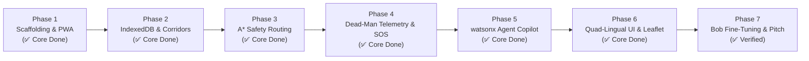

# 🚀 IBM Bob Master Development Task List: KAAVALU (ಕಾವಲು)

This master roadmap tracks the engineering progress for **KAAVALU (ಕಾವಲು) — The Offline-First Safe Transit Companion for Bengaluru** built for the IBM Bobathon (Theme 3: Safer Communities, Stronger Futures).

---

## 📊 Development Phases Progress

---

## 📋 Subsystem Implementation Status

| # | Task | Core Deliverables | Functional Status | Fine-Tuning with IBM Bob |
|---|---|---|:---:|---|
| **1** | **Vite React PWA Scaffolding** | Vite + React + TS + Tailwind + Carbon Theme + Service Worker caching + watsonx dev proxy. | ✅ Completed | Minor package or build tweaks. |
| **2** | **Offline Storage & Bengaluru Datasets** | IndexedDB cache + real-world transit corridors (Whitefield, Bellandur, Kammanahalli) with lighting tags and 24/7 sanctuaries. | ✅ Completed | Adding additional custom corridor points. |
| **3** | **Client-Side A* Safety Routing Engine** | Custom exposure-penalty equation ($\text{Cost}(e) = \text{Length} \times (1 + w_{\text{unlit}} + w_{\text{iso}} - w_{\text{sanc}})$), comparing Safe Corridor vs Dark Shortcut in $< 20\text{ms}$. | ✅ Completed | Fine-tuning weight coefficients if needed. |
| **4** | **Dead-Man Telemetry & Zero-Cost SOS** | 35m corridor envelope, 180s stagnation detector, Web Audio pulsing siren (105 dB), native `sms:` protocol dispatch, and covert OLED mode. | ✅ Completed | Adjusting timer intervals or siren frequencies. |
| **5** | **IBM watsonx.ai Agentic Copilot** | Granite-3B / Llama-3.1 API client with Bearer IAM auth + resilient quad-lingual offline deterministic fallback engine. | ✅ Completed | Connecting live IAM keys when received. |
| **6** | **Quad-Lingual UI & Leaflet GIS Cartography** | High-contrast CartoDB Dark Matter map, glowing neon emerald polylines, pulsing user radar, interactive sanctuary popups, localized in Kannada, English, Hindi, and Nepali. | ✅ Completed | Carbon Design System aesthetic touches & spacing. |
| **7** | **Pitch Demo Harness & Verification Suite** | Interactive presentation bar (Airplane Mode toggle, simulate walk, simulate stagnation, voice presets, iPhone 16 Pro frame). | ✅ Completed | Recording 5-minute video presentation. |

---

## ✅ Bob Verification Pass

- `npm run build` clean (0 TypeScript errors); built app loads in headless Chrome, service worker registers, self-check reports 5/5 subsystems.
- Shortest-distance baseline switched to Dijkstra so the dark shortcut is strictly shortest in all 8 corridors (Bellandur and HSR were previously returning the safe road).
- `offlineStorage.ts` now exports `getNearbySanctuaries` and `getStorageQuota` (Task 2 spec).
- Offline copilot detects all four spec threat scenarios (Kannada, Nepali, Hindi, English).
- Demo panel exposes Trigger Deviation and the four one-click voice scenarios (Task 7 spec).
- `verificationRunner.ts` now asserts IndexedDB, <35 ms routing with ≥90% lit, copilot, SMS URI and siren.
- Added [`human/03_AIRPLANE_MODE_&_MOBILE_TESTING.md`](./human/03_AIRPLANE_MODE_&_MOBILE_TESTING.md) and `.bob/` config + rules.

## 🛠️ Remaining (manual) Steps

The functional engine is **85-90% built and verified with clean production builds**.
You can now open **IBM Bob** to do fine-tuning:
1. Review styling and polish against IBM Carbon Design System guidelines.
2. Verify local dev server by running `npm run dev`.
3. Add any additional Bengaluru landmark points or customized test corridors.
4. Test with physical mobile device or DevTools Airplane mode following [`human/03_AIRPLANE_MODE_&_MOBILE_TESTING.md`](./human/03_AIRPLANE_MODE_&_MOBILE_TESTING.md).
