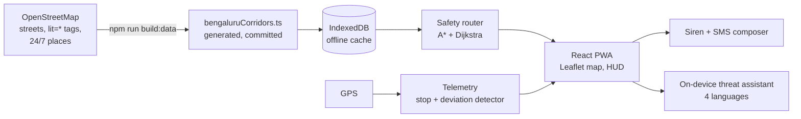

# KAAVALU (ಕಾವಲು / कावलु)
### A night-walk companion for people who get home after the shops close

**IBM Bobathon: Build for Bengaluru** · Theme 3: Safer Communities, Stronger Futures · Built with IBM Bob

*Kaavalu means "guard" or "watch" in Kannada.*

---

## Why I built this

It started at a momo stall.

My favourite momo vendor mentioned, almost in passing, that the part of his day he dreads is the trip home. The stall closes late, the lanes thin out, and he is never sure what the last stretch will look like. Around the same time, a worker at a shoe shop told me the same thing in different words: closing time is fixed by the shop, not by when it feels safe to leave.

Neither of them works in an office with a cab policy. They work in retail, street food, restaurants and cafes: the HoReCa and shop-floor jobs that keep Bengaluru running after dark. What stayed with me was how they decide whether the journey will be safe. They look at their shift. They look at the day of the week, because Fridays mean later closing, more crowds, and more people who have been drinking. Then they guess.

That guess is the whole safety system for a lot of people. Maps apps do not help, because they optimise for the shortest or fastest route. At 11 pm the shortest route is exactly the one through the unlit service lane, the underpass, or the empty stretch behind the market.

KAAVALU is my attempt to replace the guess with something concrete: **a walking route chosen for how well lit and how close to open, staffed places it is, instead of how short it is**, that keeps working when the phone has no signal.

---

## What it does

1. **Picks the safer walk, not the shortest one.** For each corridor it computes two routes: the plain shortest path, and a safety-weighted path that penalises unlit streets, dirt trails and underpasses and prefers streets near 24/7 places. It shows both, with lit percentage, distance and time, so the trade-off is visible: "6 more minutes, 800 m less in the dark".
2. **Points to real places to run to.** Along and near the route it marks police stations and any 24/7 fuel station, pharmacy or emergency hospital that OpenStreetMap tags as open round the clock.
3. **Notices when something is wrong.** If you stop moving for 3 minutes or drift more than 35 m off the planned route, it vibrates, sounds a caution tone and starts a 30-second countdown before escalating.
4. **Gets help out with no data.** The SOS button opens your phone's own SMS app with a pre-filled message containing your location, nearest haven and battery level, and you press send. A siren also sounds if a long stop goes unanswered, or when you switch it on. No server, no account, no app-store permission beyond location.
5. **Understands how people actually talk.** The on-device threat assistant reads short distress messages in Kannada, English, Hindi and Nepali ("an auto is following me", "the street is dark", "three men are standing here") and tells you where to go.
6. **Disappears into your pocket.** Pocket mode turns the screen fully black so a lit phone does not advertise you; triple-tap to unlock.

The interface is available in Kannada, English, Hindi and Nepali, because the people who work late shifts in this city do not share one language.

---

## How it works



**Routing.** Each street segment costs `length × (1 + unlit + isolation − haven)`, with an unlit penalty of 2.8, an isolation penalty of 2.0 (dirt trail) or 2.6 (underpass), and a 0.45 discount near a 24/7 haven. The safe route is A* with an admissible heuristic; the baseline "what a normal maps app would do" route is Dijkstra. Both run in well under a millisecond on a corridor of this size ([`safetyRouter.ts`](src/services/safetyRouter.ts)).

**Data is generated, not hand-drawn.** An earlier version of this repo used hand-written coordinates, and the segment lengths did not match the map. The corridors are now built by [`scripts/build-corridors.mts`](scripts/build-corridors.mts), which downloads the real walkable street network and tags for each area from OpenStreetMap, runs the app's own router over the *full* street graph, keeps only the streets the two routes use, and re-checks that the compact corridor gives the same answer. A corridor is only kept if its shortcut is genuinely shorter and genuinely less lit than the safe route. Two corridors (Electronic City, Manyata) failed that test with the data available, so they were dropped instead of faked.

**Offline.** Corridors live in IndexedDB, the service worker caches the app shell, and every safety feature above runs on the device. See [`docs/AIRPLANE_MODE_TESTING.md`](docs/AIRPLANE_MODE_TESTING.md).

**Stack.** React 18, TypeScript, Vite, Tailwind, Leaflet, `idb-keyval`. No API keys, no backend, no paid service.

### The six corridors

| Corridor | Safe route | Shortcut | Unlit distance (safe → shortcut) | Extra walking time |
|---|---|---|---|---|
| Indiranagar Metro to Defence Colony | 1,963 m · 98% lit | 1,541 m · 46% lit | 39 m → 832 m | +6 min |
| Kadugodi Metro to Nallurahalli Gate (Whitefield) | 3,198 m · 96% lit | 2,800 m · 47% lit | 128 m → 1,484 m | +6 min |
| Ecospace Skywalk to Green Glen Layout (Bellandur) | 1,405 m · 100% lit | 1,327 m · 83% lit | 0 m → 226 m | +1 min |
| Sony World Junction to 5th Block (Koramangala) | 1,959 m · 85% lit | 1,646 m · 45% lit | 294 m → 905 m | +5 min |
| HSR BDA Complex to 27th Main Sector 1 | 2,545 m · 92% lit | 2,103 m · 70% lit | 204 m → 631 m | +6 min |
| MG Road Metro to Residency Road Galleria | 1,403 m · 90% lit | 1,162 m · 56% lit | 140 m → 511 m | +3 min |

Across the six corridors the safe route has **82% less unlit walking distance** (805 m against 4,589 m) for an average of about 4.5 extra minutes.

---

## How this maps to the judging criteria

| Criterion | What KAAVALU brings |
|---|---|
| **Completeness and feasibility** | A working installable web app with six real corridors, routing, telemetry, SOS, a four-language assistant and a built-in 45-second demo. `npm run build` is clean; a startup self-check verifies the offline cache, routing speed, assistant, SMS link and siren. It needs no keys, servers or budget, so it can be tried today. |
| **Creativity and innovation** | Safety-weighted routing compared side by side with the normal shortest path, so the cost of the safer choice is shown honestly. Data pipeline built from open map data with a built-in "is this contrast real?" check. A dead-man timer and pocket mode designed for walking, not for sitting in an app. |
| **Design and usability** | Dark, high-contrast layout for night use; glanceable pills instead of dense text; one-tap SOS; Kannada, English, Hindi and Nepali for the workers this is for; works from a browser with nothing to install. |
| **Effectiveness and efficiency** | Targets a daily, unglamorous risk for retail, food and hospitality workers. Measured outcome on the shipped data: **82% less walking in unlit streets** for roughly 4.5 minutes more walking. Runs on the phone people already own, offline, at zero marginal cost, so it scales to any area OpenStreetMap covers. |

**Privacy and human review (required for safety projects).** Location stays on the device and is not sent anywhere. There is no account and no server. The SOS button never sends anything by itself: it opens the user's own SMS app with a pre-filled message, and the user decides whether to send. Safe havens are limited to police stations and places that OpenStreetMap explicitly tags as 24/7 or emergency-capable, so a person, not an algorithm, is what the app points you towards.

---

## The Bob story

IBM Bob was used throughout as a pair programmer. The seven task specs that drove the build are kept in [`docs/bob-tasks/`](docs/bob-tasks). In the final pass Bob:

- audited the project against those specs and closed the gaps (missing storage helpers, demo-panel controls that were declared but never rendered, an incomplete startup self-check, missing docs);
- found a routing bug where the "shortest" route could silently return the safe road, breaking the whole comparison, and fixed it;
- found that the dark-shortcut lengths in the hand-written data were inconsistent with the map, and wrote the OpenStreetMap generator that replaced that data;
- removed dead code, unused dependencies and stray files, and bound the dev server to localhost.

Project rules for Bob live in [`.bob/rules/`](.bob/rules/kaavalu.md).

---

## Honest limitations

- **Lighting data is thin.** Where OpenStreetMap has no `lit=*` tag, the generator treats main roads and mapped sidewalks as lit and everything else as unlit. Some corridors rest mostly on that rule rather than on tagged data (for example Koramangala has no tagged segments). The numbers above are only as good as that assumption; the next step is ground-truth lighting.
- **Few havens on some routes.** OpenStreetMap does not tag many places as 24/7, so only Indiranagar (2) and Whitefield (1) have a haven within 85 m of the route; Bellandur, Koramangala, HSR and MG Road have none.
- **The map background needs signal.** Routing, the HUD, SOS and the assistant work offline, but background map tiles are fetched live and are not yet cached, so the basemap goes blank offline.
- **The threat assistant is rule-based.** It is a keyword classifier over four languages, not a learned model.
- **Six corridors, not a city.** Coverage is a proof of concept.
- **Not tested with real users yet.**

---

## What's next

1. **Talk to the people this is for.** Sit down with the momo vendor, the shoe-shop worker and others in late-shift retail and food jobs, and test whether the routes and the language feel right.
2. **Shift-aware safety.** Use closing time and day of week (the Friday problem) to adjust the advice: when most shops on your street shut, when crowds peak, when a haven closes.
3. **Real lighting data.** Crowd-verified streetlight and haven check-ins, so lighting stops being assumed.
4. **Offline basemap.** Cache map tiles for each corridor so the whole screen works with no signal.
5. **Any street, not just six corridors.** Build the street graph on the fly from a downloaded area pack instead of pre-built corridors.
6. **Trusted contacts.** Let a user pre-select who receives the SOS text and a "reached home" message.
7. **Cloud AI as an optional layer (IBM watsonx.ai).** Use a Granite model to understand longer, messier voice or text descriptions in more languages and dialects, and to write a better incident summary, while the offline assistant stays as the fallback so safety never depends on a connection.

---

## Run it

```bash
npm install
npm run dev          # http://127.0.0.1:5173
npm run build        # type-check and production build
npm run preview      # serve the production build (needed to try the service worker)
npm run build:data   # regenerate corridors from OpenStreetMap (needs internet, can take a while)
```

Open **Pitch Presentation & Demo Simulator** at the bottom of the screen for the guided demo, airplane-mode toggle, simulated walk, stopped-walk alert and one-click distress messages in four languages.

---

## Repository guide

| Path | What's in it |
|---|---|
| `src/services/` | Safety router, telemetry, offline storage, siren, SMS dispatch, threat assistant, self-check |
| `src/components/` | Map, route cards, HUD, assistant sheet, demo panel, pocket mode |
| `src/data/bengaluruCorridors.ts` | Generated corridor data (do not edit by hand) |
| `scripts/` | OpenStreetMap corridor generator and its input |
| `docs/` | Competition brief, pitch script, submission copy, offline testing guide, Bob task specs |
| `.bob/rules/` | Project rules for IBM Bob |

---

Street, lighting and place data © [OpenStreetMap contributors](https://www.openstreetmap.org/copyright), ODbL. Code released under the [Apache 2.0 licence](LICENSE).
