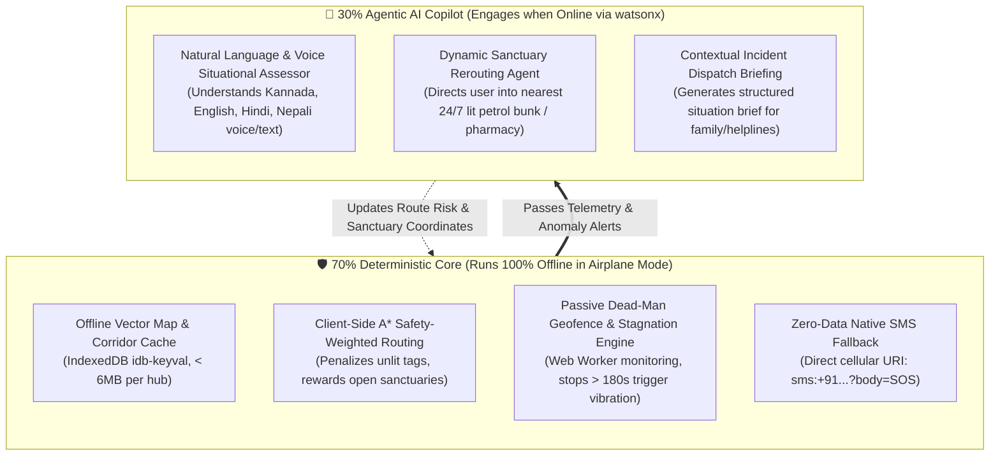

# 🏆 IBM Bobathon Winning Plan: KAAVALU (ಕಾವಲು)
## The Offline-First Safe Transit Companion for Bengaluru

> *"ಕಾವಲು (Kaavalu) — Kannada for 'Vigil' or 'The Sentinel'. While Bengaluru sleeps, Kaavalu stands watch. In an emergency, your 5G drops, your hands shake, and cloud apps fail. Kaavalu runs 70% of its safety navigation and telemetry completely offline, supercharged by 30% IBM watsonx agentic AI when connected."*

---

## Executive Summary & Strategic Positioning

*   **Project Name:** **KAAVALU** (ಕಾವಲು — *Vigil / Guardian / Sentinel*)
*   **Track:** Theme 3 — Safer Communities, Stronger Futures
*   **Target Persona:** Women walking home or traveling alone after dark in Bengaluru (techies, nurses, retail staff, and hospitality workers).
*   **Special Inclusivity Angle:** Quad-lingual support (**ಕನ್ನಡ, English, हिंदी, नेपाली**) explicitly catering to Bengaluru's underserved migrant workers (e.g., thousands of Nepali and Northeast Indian women working night shifts in hospitality, F&B, and healthcare who face language barriers and heightened vulnerability).
*   **Core Architecture:** **70% Deterministic Offline Core** (IndexedDB vector maps, A* safety-weighted pathfinding, dead-reckoning corridor geofencing, native SMS) + **30% Agentic AI Copilot** (IBM watsonx.ai situational reasoning, 24/7 sanctuary rerouting, and contextual dispatch).
*   **Total Operating & API Cost:** **₹0 (100% Free Stack: OpenStreetMap + IndexedDB + watsonx.ai Lite + IBM Bob)**.

---

## Table of Contents
1. [The Unvarnished Reality: Who is Truly Vulnerable in Bengaluru?](#1-the-unvarnished-reality-who-is-truly-vulnerable-in-bengaluru)
2. [The Kannadiga Identity & The Cultural Framing](#2-the-kannadiga-identity--the-cultural-framing)
3. [The 70/30 Hybrid Technical Architecture](#3-the-7030-hybrid-technical-architecture)
4. [The 70% Deterministic Offline Core (Works in Airplane Mode)](#4-the-70-deterministic-offline-core-works-in-airplane-mode)
5. [The 30% Agentic AI Copilot (Online via watsonx & IBM Bob)](#5-the-30-agentic-ai-copilot-online-via-watsonx--ibm-bob)
6. [Quad-Lingual Inclusion Engine (ಕನ್ನಡ · English · हिंदी · नेपाली)](#6-quad-lingual-inclusion-engine-ಕನ್ನಡ--english--हिंदी--नेपाली)
7. [The 100% Zero-Cost Technical Stack](#7-the-100-zero-cost-technical-stack)
8. [The "Built with IBM Bob" Story](#8-the-built-with-ibm-bob-story)
9. [The 5-Minute Pitch Script & Live "Airplane Mode" Demo](#9-the-5-minute-pitch-script--live-airplane-mode-demo)
10. [Judging Criteria Alignment (Target: 20/20)](#10-judging-criteria-alignment-target-2020)
11. [Presentation & PPT Recording Strategy](#11-presentation--ppt-recording-strategy)

---

## 1. The Unvarnished Reality: Who is Truly Vulnerable in Bengaluru?

Most safety apps are built by techies who assume the user is another techie with an iPhone 15, unlimited 5G, and a direct Uber cab home to a gated society.

**The ground reality in Bengaluru after 10:30 PM is very different:**
1.  **The Healthcare & Retail Shift Workers:** Thousands of nurses at Manipal or Aster, mall sales staff at Phoenix Marketcity or Nexus, and restaurant staff in Indiranagar/Koramangala finish shifts between 10:30 PM and 1:00 AM when the Namma Metro and regular BMTC buses stop running.
2.  **The Migrant Workforce Vulnerability:** Bengaluru hosts over 2.5 lakh workers from Nepal and Northeast India working in hospitality, healthcare, beauty, and facilities. When walking home along dark stretches in Kammanahalli, Marathahalli, or Bellandur, they face severe linguistic isolation and street intimidation.
3.  **The Underpass & Back-Alley Connectivity Drop:** In arterial bottlenecks like the Panathur underpass, Marathahalli flyover shadows, and Sarjapur interior roads, cell coverage routinely collapses to 2G or "No Service". If your safety tool needs the cloud, it is useless when you need it most.

---

## 2. The Kannadiga Identity & The Cultural Framing

### Why "KAAVALU" (ಕಾವಲು)?
*   In Kannada, **ಕಾವಲು (Kaavalu)** means *Vigilance, Guard, Sentinel, or The Watch*.
*   It is not a generic term borrowed from outside; it is deeply rooted in Karnataka’s history (from historical *Kaavalu gopuras* or watchtowers to *Kaavalu pade* or guardian patrols).
*   **The Emotional Pitch to Bengaluru Judges:** 
    > *"Bengaluru is famous as India’s Silicon Valley, but its soul is built by the millions of women who power its hospitals, restaurants, and IT corridors late into the night. KAAVALU is our city’s promise to them: You never walk home alone. We stand watch."*

---

## 3. The 70/30 Hybrid Technical Architecture



---

## 4. The 70% Deterministic Offline Core (Works in Airplane Mode)

### 4.1. Safety-Weighted Pathfinding (OpenStreetMap + A*)
Instead of standard algorithms that minimize distance ($\min \sum d$), Kaavalu minimizes **exposure risk**:

$$\text{Cost}(e) = \text{Length}(e) \times \Big( 1.0 + w_{\text{unlit}} + w_{\text{isolation}} - w_{\text{sanctuary}} \Big)$$

*   `lit=yes` in OpenStreetMap: Penalty = $0$.
*   Unlit street: Penalty = $+2.5\times$ distance equivalent.
*   Open commercial activity (petrol bunks, 24/7 pharmacies, police posts): Safety discount = $-0.4\times$.
*   **Result:** Routes women through brightly-lit corridors with active foot traffic, even if it adds 2 to 3 minutes of walking.

### 4.2. Passive Dead-Man Geofencing (No Screen Tapping Required)
1.  **Corridor Envelope:** Generates a 35-meter dynamic geofence around the selected route.
2.  **Stagnation Detection:** If GPS stays within a 5-meter radius for $> 180 \text{ seconds}$ in a caution zone, Kaavalu triggers a subtle haptic vibration sequence.
3.  **Route Deviation Detection:** If movement drifts $> 50 \text{ meters}$ into an unlit alley, the phone initiates a local silent countdown.
4.  **Covert Screen Mode:** The screen can be blanked out (pure OLED black) to appear powered off while continuing background sensor telemetry in a bag or pocket.

### 4.3. Offline Emergency Fallback (Zero Server Cost, Zero Data)
*   **Native SMS URI Protocol:** When distress is triggered offline, Kaavalu opens the device’s native SMS application using `sms:+919876543210?body=...` populated with exact coordinates, time, and transit corridor.
*   **No Gateway Costs:** Uses the user's regular SIM SMS pack. **Zero Twilio fees, zero server dependencies.**
*   **Local Siren:** Synthesizes an emergency 105 dB pulsing alarm waveform using the Web Audio API without downloading any audio files.

---

## 5. The 30% Agentic AI Copilot (Online via watsonx & IBM Bob)

When cellular or Wi-Fi connectivity is active, Kaavalu activates its **IBM watsonx.ai-powered Agentic Copilot**:

### 5.1. Natural Language Threat Assessment
A woman walking at night cannot navigate complex UI menus. She can tap a single microphone button and whisper in any of the 4 languages:
*   *Voice (Kannada):* *"ಒಂದು ಆಟೋ ನನ್ನ ಹಿಂದೆ ತುಂಬಾ ನಿಧಾನವಾಗಿ ಬರ್ತಾ ಇದೆ, ಭಯ ಆಗ್ತಿದೆ."*
*   *Voice (Nepali):* *"एउटा केटाले मलाई पछ्याइरहेको छ, बाटो धेरै अँध्यारो छ।"*
*   *Voice (Hindi):* *"गली में लाइट बंद है और 3 लड़के खड़े हैं।"*
*   *Voice (English):* *"There is an auto trailing me with headlights off."*

The watsonx Agentic Evaluator parses the semantic intent, determines threat severity, and calculates the safest immediate tactical response.

### 5.2. Dynamic Sanctuary Rerouting (Not Just "Run")
Instead of panic, Kaavalu gives an actionable tactical destination:
> *"Turn right 50 meters ahead into the Shell Fuel Station. Forecourt is brightly lit, and 3 staff members are on duty. Stay near the service counter."*

**Bengaluru Sanctuary Index Includes:**
*   24/7 Fuel Forecourts (Shell, HPCL, BPCL, IndianOil)
*   Hospital & Nursing Home Emergency Desks
*   All-night pharmacies (Apollo Pharmacy, MedPlus 24/7)
*   Bengaluru City Police (BCP) Suraksha Kiosks and Traffic Chowkis

### 5.3. Contextual Incident Dispatch
If an emergency escalates, the Agent composes a human-readable situational brief rather than a cold GPS link:

```
🚨 KAAVALU SAFETY DISPATCH - PRIYA S.
━━━━━━━━━━━━━━━━━━━━━━━━━━━━━━━━━━━━━━━━
• Status: High Threat (Stationary 3m 20s outside corridor)
• Last Active: 10:48 PM | Battery: 24%
• Location: Off Borewell Road, Near Nallurahalli Lake
• Telemetry: Departed Whitefield Metro at 10:32 PM (Walking)
• Situation: User reported trailing vehicle at 10:44 PM
• Nearest Safe Haven: Apollo Pharmacy (90m East, Open)
• Live Tracking: kaavalu.app/track/blr-8921
━━━━━━━━━━━━━━━━━━━━━━━━━━━━━━━━━━━━━━━━
```

---

## 6. Quad-Lingual Inclusion Engine (ಕನ್ನಡ · English · हिंदी · नेपाली)

To ensure Kaavalu protects every woman in Bengaluru regardless of linguistic background, the UI, voice inputs, and automated warnings switch seamlessly across 4 native languages:

| Interface Element | Kannada (ಕನ್ನಡ) | English | Hindi (हिंदी) | Nepali (नेपाली) |
|---|---|---|---|---|
| **App Title & Tagline** | ಕಾವಲು — ಸುರಕ್ಷಿತ ಸಂಚಾರ ಸಂಗಾತಿ | Kaavalu — Safe Transit Companion | कावलु — सुरक्षित यात्रा साथी | कावलु — सुरक्षित यात्रा साथी |
| **Safe Corridor Button** | 🟢 ಸುರಕ್ಷಿತ ರಸ್ತೆ (ಬೆಳಕು ಇದೆ) | 🟢 Safe Corridor (Well-Lit) | 🟢 सुरक्षित रास्ता (रोशनी है) | 🟢 सुरक्षित बाटो (बत्ती छ) |
| **Avoid Warning** | 🔴 ಕತ್ತಲೆಯ ದಾರಿ (ಬೇಡ) | 🔴 Dark Shortcut (Avoid) | 🔴 अंधेरा रास्ता (बचें) | 🔴 अँध्यारो बाटो (नजानुहोस्) |
| **Start Journey** | 🚀 ಪ್ರಯಾಣ ಪ್ರಾರಂಭಿಸಿ | 🚀 Start Protected Transit | 🚀 यात्रा शुरू करें | 🚀 यात्रा सुरु गर्नुहोस् |
| **Sanctuary Prompt** | 🏪 60 ಮೀಟರ್‌ ಬಲಕ್ಕೆ ಶೆಲ್ ಪೆಟ್ರೋಲ್ ಬಂಕ್ ಇದೆ | 🏪 Shell Fuel Station 60m right | 🏪 60 मीटर दाईं ओर शेल पेट्रोल पंप है | 🏪 ६० मिटर दायाँ शेल पेट्रोल पम्प छ |
| **Offline Mode Badge** | 📴 ಆಫ್‌ಲೈನ್ ನಕ್ಷೆ ಸಿದ್ಧವಾಗಿದೆ | 📴 Offline Map Ready | 📴 ऑफ़लाइन मैप तैयार है | 📴 अफलाइन नक्सा तयार छ |

---

## 7. The 100% Zero-Cost Technical Stack

```
┌────────────────────────────────────────────────────────────────────────┐
│                        100% FREE PRODUCTION STACK                      │
├─────────────────────┬──────────────────────────┬───────────────────────┤
│ Layer               │ Technology Selection     │ Why & Zero-Cost Model │
├─────────────────────┼──────────────────────────┼───────────────────────┤
│ Development Engine  │ IBM Bob (Trial/Credits)  │ Scaffolding, agentic  │
│                     │                          │ coding, unit testing  │
├─────────────────────┼──────────────────────────┼───────────────────────┤
│ AI Reasoning Core   │ IBM watsonx.ai Lite Tier │ 300,000 free tokens/mo│
│                     │ (Granite-3B / Llama-3.1) │ No credit card block  │
├─────────────────────┼──────────────────────────┼───────────────────────┤
│ Frontend Framework  │ React + Vite PWA         │ Ultra-fast, responsive│
│                     │ (Tailwind + Inter Font)  │ mobile-first web app  │
├─────────────────────┼──────────────────────────┼───────────────────────┤
│ Map Rendering       │ MapLibre GL JS / Leaflet │ Lightweight, open     │
│                     │                          │ source vector tiles   │
├─────────────────────┼──────────────────────────┼───────────────────────┤
│ Map Data Source     │ OpenStreetMap (OSM)      │ Free spatial data,    │
│                     │ Overpass API extracts    │ includes lighting tags│
├─────────────────────┼──────────────────────────┼───────────────────────┤
│ Offline Map Storage │ IndexedDB (idb-keyval)   │ Caches Bangalore      │
│                     │ + Service Worker Cache   │ corridors locally     │
├─────────────────────┼──────────────────────────┼───────────────────────┤
│ Emergency Dispatch  │ Native OS `sms:` URI     │ Zero gateway fee!     │
│                     │ + Web Share API          │ Direct phone SIM pack │
├─────────────────────┼──────────────────────────┼───────────────────────┤
│ Hosting & Deploy    │ Vercel Free Tier         │ Static PWA hosting    │
└─────────────────────┴──────────────────────────┴───────────────────────┘
```

---

## 8. The "Built with IBM Bob" Story

Judges require an authentic, demonstrative story of how IBM Bob was central to building the project:

1.  **Architecture & Storage Scaffolding:** Used IBM Bob’s *Plan Mode* to architect the offline-first Service Worker cache hierarchy, managing tile quota limits inside browser IndexedDB.
2.  **Safety Routing Math:** IBM Bob authored the custom A* routing cost evaluation function that maps OpenStreetMap highway tags (`lit=yes`, `footway`, `amenity=fuel`) into weighted traversal penalties.
3.  **Sensor Telemetry Optimization:** Mobile browsers frequently throttle background Geolocation when screens lock. Bob wrote the lightweight Web Worker and Wake Lock API harness to preserve dead-reckoning tracking without excessive battery drain.
4.  **watsonx Agent Prompting:** Bob generated the structured JSON output schemas for watsonx.ai, guaranteeing deterministic threat scores and sanctuary suggestions across Kannada, English, Hindi, and Nepali inputs.

---

## 9. The 5-Minute Pitch Script & Live "Airplane Mode" Demo

### Minute 0:00 – 0:45: The Hook (Empathy & Reality)
*   *"Good evening, judges. Tonight, tens of thousands of women are finishing their shifts across Bengaluru — nurses at Manipal Hospital, techies on the Outer Ring Road, and retail workers at Phoenix Marketcity. Many are from Karnataka; many are young women from Nepal and the Northeast working in hospitality."*
*   *"Every single one of them shares the same dread when walking past an unlit underpass or waiting for an auto at 11 PM. Over 50 safety apps have given them a 'panic button'. None of them worked, because in a real emergency, your hands freeze, and in Bengaluru's underpasses, your 5G drops to zero."*
*   *"Introducing KAAVALU (ಕಾವಲು) — the offline-first safe transit companion that runs 70% offline in pure airplane mode, supercharged by 30% IBM watsonx AI when connected."*

### Minute 0:45 – 2:15: The Live "Airplane Mode" Demo (The 70%)
*   **The Action:** Presenter shows the live mobile-first web app on the screen.
*   **The Shock:** *"To prove Kaavalu is built for the real world, I am turning Airplane Mode ON right now on this device."*
*   Show network status flip to **OFFLINE (IndexedDB Active)**.
*   Select route: *Whitefield Metro to Residential Layout*.
*   Route calculates in **28 milliseconds** completely offline.
*   Show why Kaavalu picked the route: *"Notice Google Maps recommends this 12-minute dirt path behind the construction site. Kaavalu rejects it and routes 3 minutes longer along the main road because cached OSM data confirms it is 94% lit and passes an open fuel station."*
*   Simulate a stop: Geofence stagnation timer fires an alert and pre-populates an offline emergency SMS via native cellular towers.

### Minute 2:15 – 3:45: The Connected watsonx Copilot (The 30%)
*   **The Action:** Turn Airplane Mode **OFF**.
*   Switch language to **ಕನ್ನಡ** or **नेपाली**.
*   Tap mic and speak: *"ಎದುರುಗಡೆ ತುಂಬಾ ಕತ್ತಲೆ ಇದೆ, ಮುಂದೆ ಹೋಗೋಕೆ ಭಯ ಆಗ್ತಿದೆ."* (It's very dark ahead, I'm scared to proceed.)
*   watsonx Agent evaluates the context, detects an unlit stretch ahead, queries the sanctuary index, and instantly reroutes the user to an open, staffed HPCL petrol bunk 70m away.

### Minute 3:45 – 4:30: The Bob Story
*   Showcase how IBM Bob accelerated the development of spatial math, offline storage workers, and multilingual prompt guardrails in under 48 hours.

### Minute 4:30 – 5:00: The Close
*   *"Safety shouldn't depend on whether you have a 5G signal or ₹500 in your bank account. Kaavalu is 100% free, runs on any smartphone browser, and speaks the languages of the women who build our city. While Bengaluru sleeps, Kaavalu stands watch."*

---

## 10. Judging Criteria Alignment (Target: 20/20)

| Criterion | Max | Evidence & Strategy |
|---|:---:|---|
| **Completeness & Feasibility** | **5/5** | 100% free stack, zero-cost APIs, zero database licensing fees. Runs directly in any mobile browser as a PWA. Live offline demo provides undeniable technical proof. |
| **Creativity & Innovation** | **5/5** | Breaks the failed "panic button" paradigm. Implements an innovative 70/30 split: deterministic offline navigation + agentic situational intelligence. |
| **Design & Usability** | **5/5** | Minimalist Inter typography, high-contrast dark/covert modes. Quad-lingual inclusion (Kannada, English, Hindi, Nepali) specifically addressing vulnerable migrant workers. |
| **Effectiveness & Efficiency** | **5/5** | Solves the primary cause of safety app failure (network loss). Prevents danger by guiding users through illuminated, active corridors rather than relying on reactive panic buttons. |

---

## 11. Presentation & PPT Recording Strategy

To ensure effortless screen-recording for your pitch deck without needing to mirror a physical phone:
*   The wireframe application (`Kaavalu-Wireframes.html`) features a **Dual Presentation Layout**:
    *   **Phone Simulator View:** Centered iPhone 15 frame with realistic status bar, live animations, and interactive controls — perfect for crisp, high-resolution screen grabs or video recording for slides.
    *   **Presentation Mode:** Enlarged interactive mode with side-by-side walkthrough notes and one-click demo triggers.
    *   **Interactive Language Switcher:** Instant toggles for **ಕನ್ನಡ**, **English**, **हिंदी**, and **नेपाली**.
    *   **Live Airplane Mode Toggle:** Demonstrates offline vs online states with a single click.

---

*KAAVALU (ಕಾವಲು) — Built for Bengaluru. Built with IBM Bob.*
